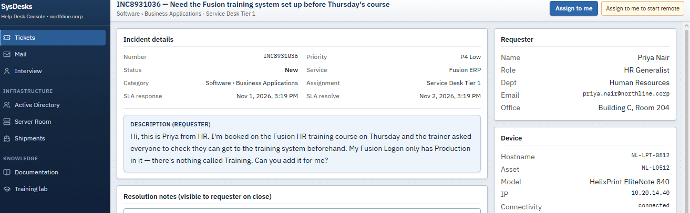
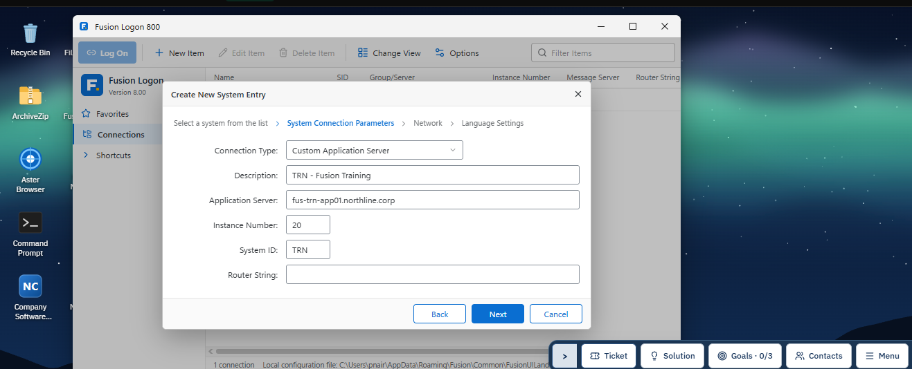
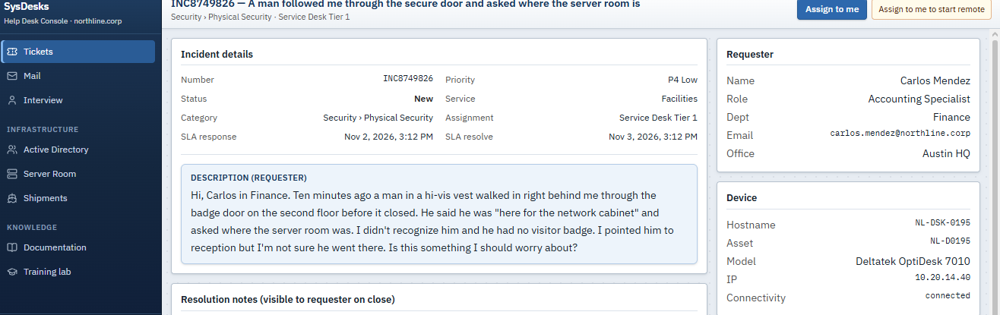
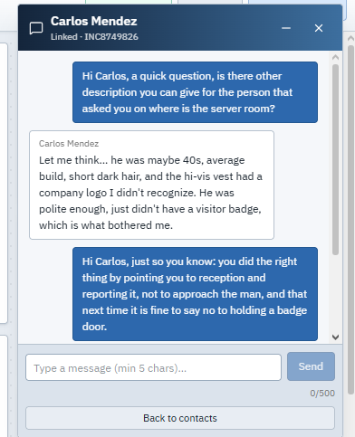
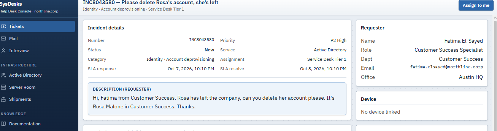
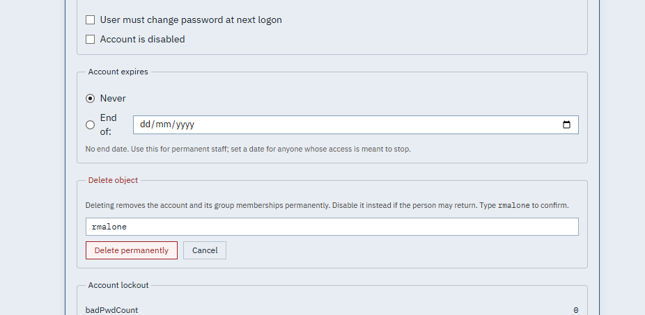
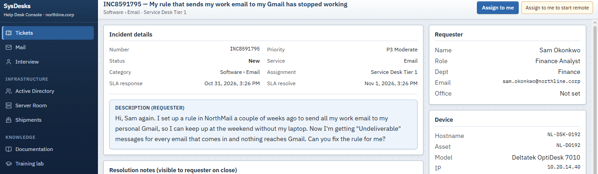
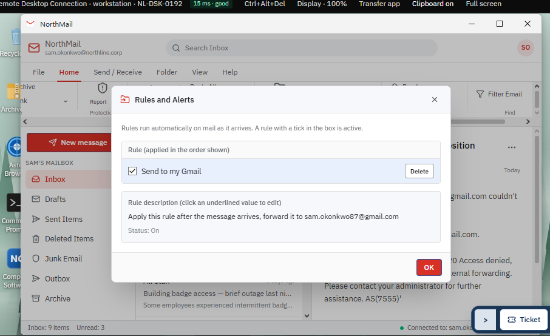
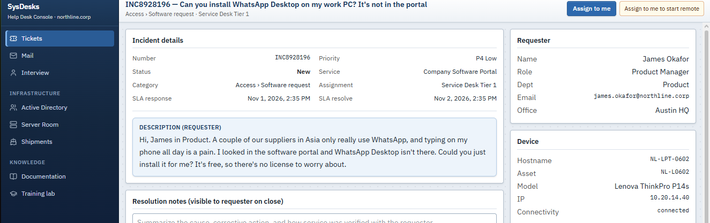

<h1>Week 4 Helpdesk Exercise</h1>
<a href = "https://www.google.com/url?sa=t&rct=j&q=&esrc=s&source=web&cd=&cad=rja&uact=8&ved=2ahUKEwiAp_zl0-mXAxWZsFYBHS0mM5MQFnoECBEQAQ&url=https%3A%2F%2Fsysdesks.com%2F&usg=AOvVaw3JZRWmcdfUv9AB3_rGtlEy&opi=89978449">Helpdesk Simulator</a>

<h2>Ticket 1</h2>

<strong>Problem Description</strong>

The user reported an accessibility issue regarding a scheduled training course within the Fusion platform. Although the user was actively enrolled in the specific training course, the corresponding course materials and session entries failed to populate or appear automatically within the main application dashboard interface. This display discrepancy prevented the user from accessing required learning modules and tracking their course progression directly from their standard account overview.

<strong>Solution/Action Taken</strong>

To resolve the issue, an administrator accessed the user's Fusion account directly to update their curriculum permissions. Navigating to the profile management interface, the administrator selected the "Add Item" option from the account settings menu. From the available system configuration options, the administrator assigned and linked the Training (TRN) item category to the user's account. This manual assignment successfully re-indexed the course catalog, rendering the missing training course visible and fully accessible on the user's application interface.

<h2>Ticket 2</h2>

<strong>Problem Description</strong>

Somebody unfamiliar wearing a hi-vest followed an employee closely, that person then asked on the location if the network cabinet. The employee instead pointed to the direction of the receptionist. 

<strong>Solution/Action Taken</strong>

This is a possible tailgating attempt. One of the first thing I did is to ask for more description of the unfamiliar person’s appearance as he could still be in the area, I then complemented the employee for a great response to the situation. Lastly, I escalate the ticket to the security team with all the gathered information for a smooth hand-off

<h2>Ticket 3</h2>

<strong>Problem Description</strong>

The IT support team received a ticket regarding an active account belonging to a former employee that was still present within Active Directory. Because removing a user account from Active Directory is an irreversible action, confirmation was requested from the ticket submitter to ensure authorization and prevent accidental deletion. Upon receiving confirmation that the individual was no longer with the organization, the account was identified for permanent removal from the domain directory.

<strong>Solution/Action Taken</strong>

After validating the authorization request, I then opened Active Directory and located the target ex-employee account. Navigated to the account settings section for that profile and executed the permanent deletion action. The account has been successfully removed from Active Directory, effectively revoking domain access and completing the offboarding request.

<h2>Ticket 4</h2>

<strong>Problem Description</strong>

The user reported an issue where work emails sent to their official company email address were failing to forward automatically to their personal email account. Upon initial review, the company mailbox itself was actively receiving incoming messages, indicating that domain routing and core mailbox functionality were fully operational. The failure was isolated to an internal redirection flow, suggesting an issue within the user's specific inbox rule configurations or forwarding settings rather than a system-wide mail server outage.

<strong>Solution/Action Taken</strong>

To resolve the issue, I remote access into the user’s mail account settings and navigated to the Rules section, selecting Manage Rules to inspect the existing routing logic. Diagnostic checks revealed that the specific rule configured to redirect incoming messages to the user's personal email address had been disabled. The administrator toggled the rule back to the On status and saved the changes. A test message confirmed that incoming company emails are now successfully auto-forwarding to the target personal inbox.

<h2>Ticket 5</h2>

<strong>Problem Description</strong>

The employee requested permission/assistance to download and install WhatsApp on their workstation.

<strong>Solution/ Action Taken</strong>

As a Tier 1 Technician, I do not have authorization to approve software installations of this nature. Furthermore, company policies require business communications to be retained for compliance and record-keeping purposes; using a personal messaging platform like WhatsApp requires prior review and approval from management. The request has been escalated to management/Tier 2 for review.

<h2>Key Takeaways & Learnings This Week:</h2>
<ul>
  <li>Role Boundaries & Scope: Gained a clearer understanding of the exact scope and limitations of a Tier 1 IT Helpdesk role, specifically regarding operational authority and protocol execution.</li>
  <li>UI & Application Familiarity: Recognized the importance of mastering essential application layouts and navigation to efficiently guide users and resolve software-related issues.</li>
  <li>Escalation Protocols: Learned to identify requests that require policy compliance or administrative approval, ensuring proper escalation to higher-level support or management.</li>
</ul>
